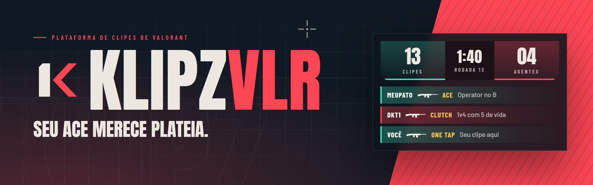
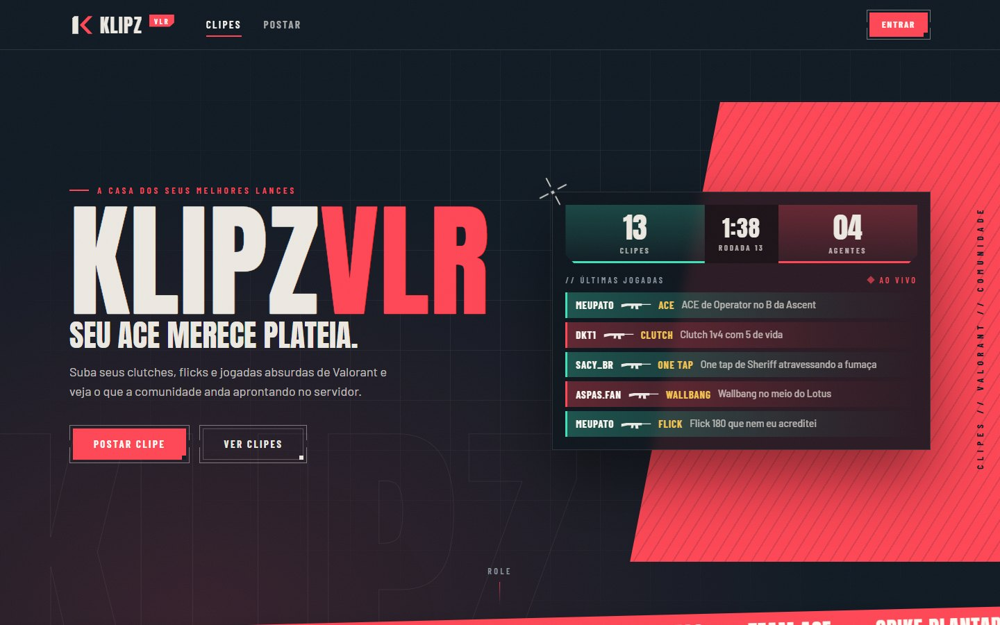
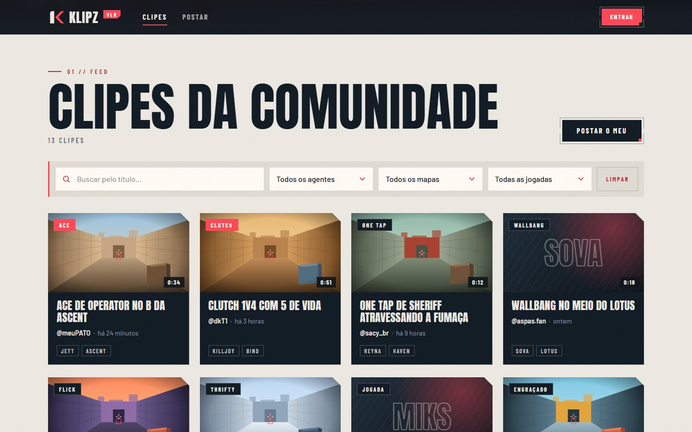
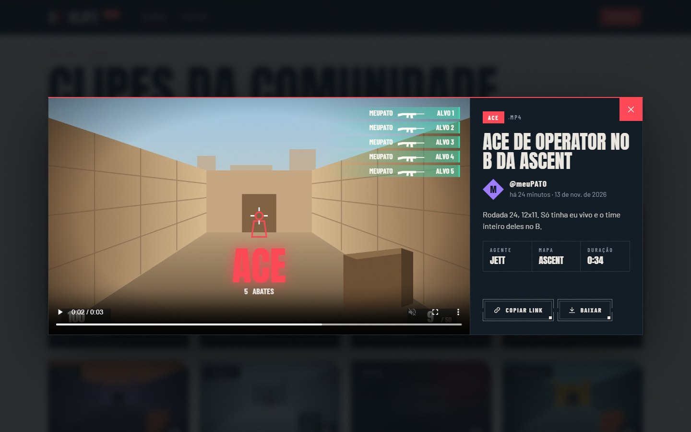
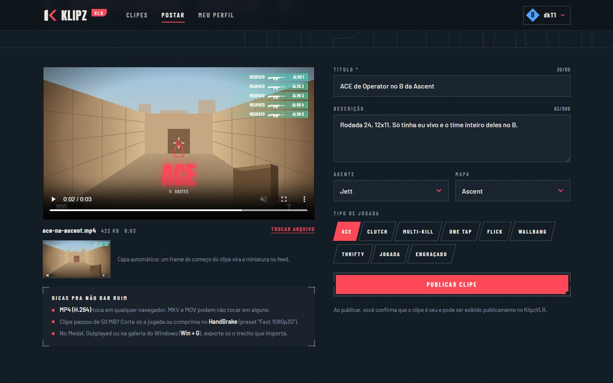
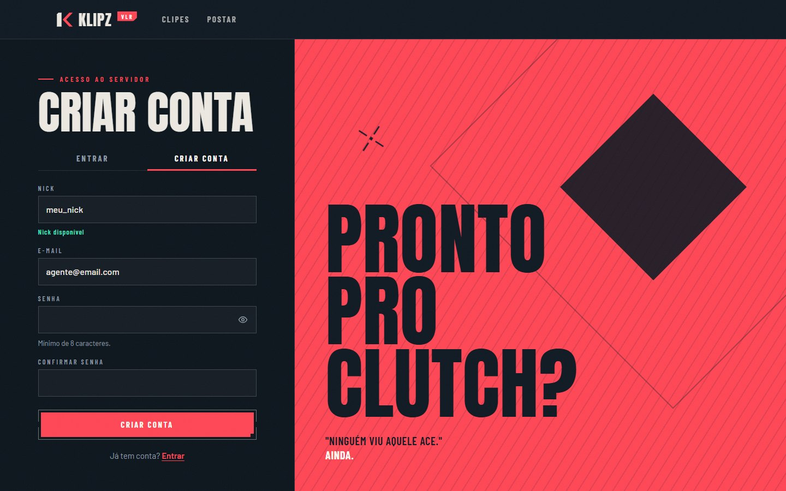
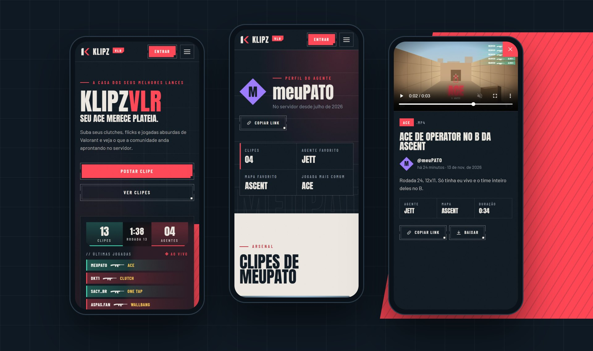
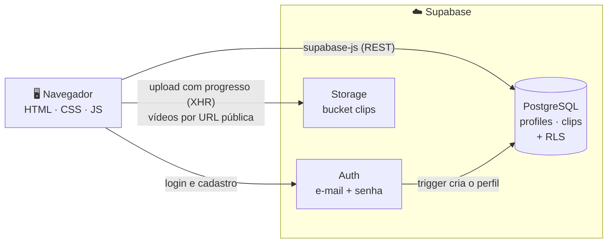

<div align="center">



<br>

**Poste seus aces, clutches e flicks de Valorant e assista às jogadas da comunidade.**<br>
HTML, CSS e JavaScript puro no front, Supabase no back. Sem framework, sem build.

<br>


[Telas](#-telas) ·
[Funcionalidades](#-funcionalidades) ·
[Tecnologias](#-tecnologias) ·
[Arquitetura](#-arquitetura) ·
[Como rodar](#-como-rodar) ·
[Deploy](#-deploy) ·
[Estrutura](#-estrutura-do-projeto)

</div>

---

## 📸 Telas

<p align="center">
  
</p>

| Feed com filtros | Player do clipe |
|:---:|:---:|
|  |  |
| **Postar clipe** | **Cadastro** |
|  |  |

<p align="center">
  
</p>

<p align="center"><sub>Prints com dados de exemplo.</sub></p>

---

## ✨ Funcionalidades

- 🎬 **Feed de clipes** com busca por título, filtros por agente, mapa e tipo de jogada (ACE, CLUTCH, ONE TAP…) e botão "carregar mais".
- ▶️ **Player** com link compartilhável (`index.html?clip=<id>`), download e dados do clipe (agente, mapa e duração).
- 🔐 **Contas com e-mail e senha.** O nick é único e o site avisa na hora se já está em uso.
- ⬆️ **Upload de vídeo**:
  - Formatos MP4, WEBM, MOV, MKV, M4V e OGV.
  - Arrastar e soltar, com barra de progresso.
  - **Capa gerada automaticamente** no navegador.
- 👤 **Perfil** com estatísticas (agente favorito, mapa favorito, jogada mais comum) e exclusão dos próprios clipes.
- 📊 **HUD na home**, igual ao do jogo: placar com o total de clipes e jogadores e um *kill feed* com as últimas jogadas.
- 🛡️ **Segurança no banco** (Row Level Security):
  - Visitante só assiste.
  - Cada usuário só posta na própria pasta e só apaga o que é dele.
- 📱 **Responsivo e acessível**: funciona no celular, navegação por teclado, foco visível e respeito ao `prefers-reduced-motion`.
- 🤫 **Um easter egg escondido.** Spoiler no fim da página.

---

## 🧰 Tecnologias

| Camada | Tecnologia | Para quê |
|---|---|---|
| Estrutura | **HTML5** semântico | 4 páginas: home, entrar, postar e perfil |
| Visual | **CSS3** puro (custom properties, grid, `clip-path`, animações) | Identidade visual no estilo Valorant |
| Lógica | **JavaScript** (ES2020+, sem framework e sem build) | Interface, chamadas ao Supabase e upload |
| Back-end | **[Supabase](https://supabase.com)** | Banco, login e arquivos, sem servidor próprio |
| Banco | **PostgreSQL** com **RLS**, trigger e função SQL | Tabelas `profiles` e `clips` com regras de acesso |
| Login | **Supabase Auth** | Cadastro e login por e-mail e senha |
| Arquivos | **Supabase Storage** | Bucket público `clips` com vídeos e capas |
| SDK | **supabase-js 2.117.3** (via CDN jsDelivr) | Cliente oficial do Supabase |
| Fontes | **Google Fonts**: Anton, Barlow e Barlow Condensed | Tipografia condensada parecida com a do jogo |
| APIs do navegador | Canvas, XMLHttpRequest, Clipboard, History, `Intl` | Capa automática, progresso do upload, copiar link, URLs compartilháveis e datas como "há 2 horas" |

### Como funciona por dentro

- **Upload com progresso.** O SDK não informa o progresso do envio. Por isso o vídeo vai direto para a API REST do Storage via `XMLHttpRequest`, no mesmo formato *multipart* que o SDK usa, com o token do usuário logado.
- **Capa automática, sem servidor.** O vídeo é aberto num `<video>` invisível e avança até ~25% da duração. Esse frame é desenhado num `<canvas>` e vira um JPEG 640×360.
- **Perfil criado pelo banco.** Um *trigger* no Postgres (`on_auth_user_created`) cria o perfil com o nick escolhido no cadastro. Se o nick já existir, ganha um sufixo.
- **Regras no banco, não no navegador.** O cadastro do clipe só é aceito se o vídeo estiver na pasta `<user_id>/` do próprio usuário. Ninguém consegue postar em nome de outra pessoa nem apontar para o arquivo de outro.
- **Tudo vira link.** Filtros e clipes abertos ficam na URL, como `?agente=Jett&mapa=Ascent` ou `?clip=<id>`.

---

## 🧩 Arquitetura



### Modelo de dados

| Tabela | Campos principais |
|---|---|
| `profiles` | `id` (= usuário do Auth) · `username` (3–20 caracteres, único sem diferenciar maiúsculas) · `created_at` |
| `clips` | `id` · `user_id` → `profiles` · `title` · `description` · `agent` · `map` · `highlight` · `video_path` · `thumb_path` · `duration` · `created_at` |
| Storage `clips` | `<user_id>/<clip_id>.<ext>` (vídeo) e `<user_id>/<clip_id>.jpg` (capa) · até 50 MB por arquivo |

### Quem pode o quê

| Ação | Visitante | Logado | Dono do clipe |
|---|:---:|:---:|:---:|
| Ver clipes e perfis | ✅ | ✅ | ✅ |
| Postar clipe (na própria pasta) | ❌ | ✅ | ✅ |
| Apagar clipe e arquivos | ❌ | ❌ | ✅ |

Tudo isso está em [`supabase/schema.sql`](supabase/schema.sql).

---

## 🚀 Como rodar

**Você vai precisar de:**
- um navegador;
- o [VS Code](https://code.visualstudio.com) com a extensão **Live Server** (ou qualquer servidor estático);
- uma conta grátis no [Supabase](https://supabase.com).

### 1. Clonar o repositório

```bash
git clone https://github.com/SEU-USUARIO/KlipzVLR.git
cd KlipzVLR
```

### 2. Criar o projeto no Supabase

1. Em [supabase.com](https://supabase.com), clique em **New project**.
   - **Nome:** o que quiser.
   - **Senha do banco:** gere uma e guarde.
   - **Região:** *South America (São Paulo)*.
2. Vá em **SQL Editor → New query**, cole todo o [`supabase/schema.sql`](supabase/schema.sql) e clique em **Run**.
   - Se aparecer o aviso de *destructive operation*, pode confirmar: o script não apaga dados e pode ser rodado de novo quando quiser.
   - Ele cria as tabelas, as regras de segurança, o trigger, o bucket de vídeos e as permissões da API.
3. Em **Authentication → Sign In / Providers**, desligue **Confirm email** e salve.

> **Por que desligar?** Sem um servidor de e-mail próprio (SMTP), o Supabase só envia e-mails para membros do time do projeto, e no máximo uns 2 por hora. Ou seja, ninguém de fora conseguiria confirmar a conta.
> Para um site público "de verdade", configure um SMTP (Resend, Brevo…) em **Authentication → Emails** e ligue a confirmação de novo.

### 3. Conectar o site ao projeto

Copie dois dados do painel:
- a **Project URL**, em **Project Settings → Data API** ou no botão **Connect**;
- a **Publishable key** (`sb_publishable_…`), em **Project Settings → API Keys**.

Cole os dois em [`js/config.js`](js/config.js):

```js
window.KLIPZ_CONFIG = {
  SUPABASE_URL: 'https://SEU-PROJETO.supabase.co', // sem /rest/v1 no final
  SUPABASE_KEY: 'sb_publishable_...',
  BUCKET: 'clips',
  MAX_UPLOAD_MB: 50,
};
```

> 🔑 **A *publishable key* é pública por natureza**: ela vai para o navegador de todo mundo e pode ir para o GitHub. Quem protege os dados são as regras do `schema.sql`.
> **Nunca** coloque no código a *secret key* nem a *service_role*.

### 4. Rodar

No VS Code, clique com o botão direito no `index.html` e escolha **Open with Live Server**. O site abre em `http://127.0.0.1:5500`.

Também funciona com:

```bash
npx serve .                 # Node.js
python -m http.server 5500  # Python
```

Se aparecer uma faixa amarela dizendo "Supabase não configurado", confira o passo 3.

---

## 🌐 Deploy

O site é 100% estático, então qualquer hospedagem gratuita serve:

- **GitHub Pages:** no repositório, vá em **Settings → Pages**, escolha *Deploy from a branch* e marque `main` / `root`. O site fica em `https://SEU-USUARIO.github.io/KlipzVLR/`.
- **Netlify:** arraste a pasta do projeto em [app.netlify.com/drop](https://app.netlify.com/drop).
- **Vercel:** importe o repositório. Não precisa de comando de build.

Se um dia ligar o "Confirm email", coloque o endereço publicado em **Authentication → URL Configuration** (Site URL e Redirect URLs).

---

## 📁 Estrutura do projeto

```
KlipzVLR/
├── index.html            # home: hero com HUD, feed, filtros e player
├── entrar.html           # login e cadastro
├── postar.html           # upload de clipe (só logado)
├── perfil.html           # perfil próprio ou público (?u=nick)
├── css/
│   └── style.css         # todo o visual (tokens, componentes, responsivo)
├── js/
│   ├── config.js         # ⚙️ URL e chave do Supabase
│   ├── core.js           # cliente Supabase, sessão, header, utilidades, agentes e mapas
│   ├── clips.js          # cards, player e exclusão
│   ├── home.js           # feed, filtros, placar e kill feed
│   ├── entrar.js         # login e cadastro
│   ├── postar.js         # upload com progresso e capa automática
│   ├── perfil.js         # perfil e estatísticas
│   └── easter-egg.js     # 🤫
├── img/                  # favicon e imagens do site
├── supabase/
│   └── schema.sql        # banco, RLS, trigger, função e bucket
└── docs/                 # banner e prints deste README
```

---

## 📏 Limites do plano gratuito

| Recurso | Limite no plano Free |
|---|---|
| Tamanho por arquivo | **50 MB** |
| Armazenamento total | **1 GB** (cerca de 30 a 40 clipes de 25–30 MB) |
| Tráfego de saída | **5 GB por mês**. Cada vez que alguém assiste a um clipe, conta. |
| Inatividade | O projeto **pausa depois de 7 dias sem uso**. É só reativar no painel. |

**Dicas para o clipe caber:**
- Corte só a jogada.
- Comprima no [HandBrake](https://handbrake.fr) com o preset *Fast 1080p30*.
- Grave em **MP4 (H.264)**, que toca em qualquer navegador.

---

## 🔧 Problemas comuns

| O que aparece | O que fazer |
|---|---|
| Faixa amarela "Supabase não configurado" | Preencha e salve o `js/config.js`. |
| Nada carrega e o console mostra `/rest/v1/rest/v1` | Tire o `/rest/v1` do fim da `SUPABASE_URL`. |
| "Tabelas não encontradas" | Rode o `supabase/schema.sql` no SQL Editor. |
| "Sem permissão no banco" / `permission denied` | Rode o `schema.sql` inteiro de novo (ele tem os `GRANT`s). |
| "Limite de e-mails do Supabase atingido" | Desligue **Confirm email**. |
| O cadastro pede para confirmar o e-mail | **Confirm email** ainda está ligado. |
| Upload recusado por tamanho | O clipe passou de 50 MB. |
| O clipe sobe mas não toca | Codec que o navegador não lê (HEVC/H.265, alguns MKV). Converta para MP4 H.264. |
| Tudo parou de funcionar do nada | O projeto Free pausou por inatividade. Reative no painel. |
| Abrir o `index.html` com dois cliques não funciona direito | Use o Live Server (ou outro servidor local). |

---

## 🎨 Personalizar

- **Agente ou mapa novo no jogo:** edite `KZ.AGENTS` e `KZ.MAPS` em [`js/core.js`](js/core.js).
- **Tipos de jogada:** `KZ.HIGHLIGHTS`, no mesmo arquivo.
- **Cores e fontes:** variáveis no topo do [`css/style.css`](css/style.css) (`--red`, `--navy`, `--cream`…).
- **Limite de upload:** `MAX_UPLOAD_MB` no `config.js` e `file_size_limit` no `schema.sql`. No plano Free, o máximo é 50 MB.

---

## 👥 Autores

Feito por **Julio "meuPATO"** e **Vini "dkT1"**.

<details>
<summary>🤫 <b>Easter egg</b> (spoiler)</summary>

<br>

Os criadores estão escondidos numa tela secreta de **seleção de agente**, com habilidades próprias. Para abrir:

- Código Konami no teclado: `↑ ↑ ↓ ↓ ← → ← → B A`
- Digitar `meupato` ou `dkt1` em qualquer página (fora de campos de texto)
- Clicar 5 vezes seguidas no logo, na página inicial
- Clicar 3 vezes em "feito por 2 agentes", no rodapé

Escolha um agente e aperte **TRAVAR**.

</details>

---

<sub>KlipzVLR é um projeto de fã, sem afiliação com a Riot Games. VALORANT e os nomes relacionados são marcas da Riot Games, Inc. As imagens dos prints são ilustrações de exemplo, não capturas do jogo.</sub>
